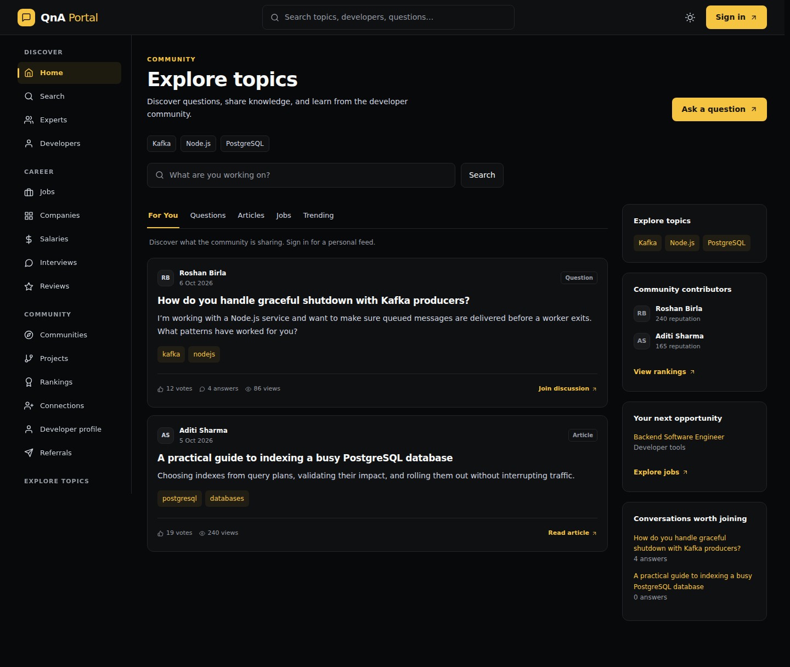
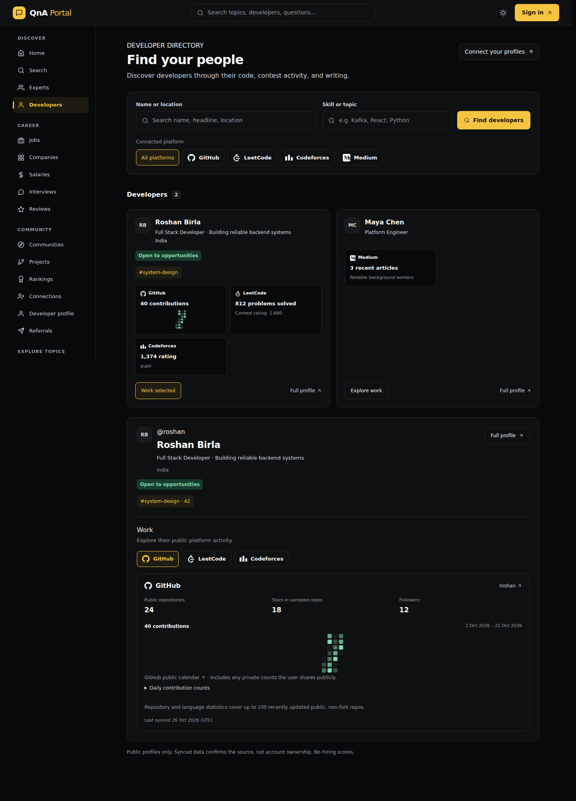
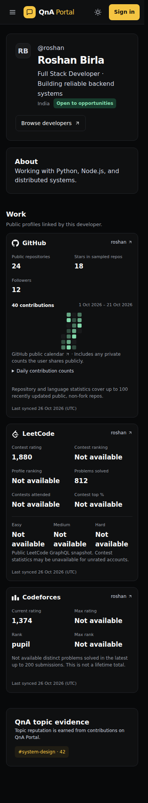

# Linear theme verification — 27 October 2026

The approved Linear concept is implemented with charcoal surfaces, warm yellow actions/selection, compact feed cards, underlined feed filters, and a two-column developer directory. Public profiles share the same tokens, Avatar fallback, and platform Work components. The detailed Work explorer remains beneath the directory cards so existing developer/work URLs continue to work.

This PR starts from main at 03b3db6 and is an alternative to the unmerged Open Hub theme PR #48. Choose one visual direction; do not merge both independently.

## Review frames

These are screenshots of the production frontend build using synthetic API fixtures. They are not live member statistics or production data.

## Validation

- Frontend ESLint: passed.
- Component tests: 5 suites, 16 tests passed. Includes public-only filtering, URL selection/Back, retry, profile editing, and missing-date calendar preview coverage.
- Production build: passed. No new application dependencies or lockfile changes.
- DESIGN.md lint: 0 errors, 9 unused-token warnings. Runtime CSS remains canonical.
- Full-project strict design audit: 52 findings before and after; no new rule/file/message findings. Existing legacy form/date/select ownership findings are outside this visual migration.
- Chromium: feed, developer directory, and public developer profile at 1440, 1024, 768, 390, and 320px. No document overflow or uncaught page errors.
- Browser checks: search clear/focus, light/dark toggle and persistence, dark first-visit default, directory filters/reset, developer URL selection and Back, loading/empty/error/retry, ranking URL filters/validation, mobile drawer keyboard containment/Escape focus restoration/navigation, and reduced motion.

Browser fixtures do not certify live database connectivity, production sign-in, external account synchronization, or real platform ownership. Existing publication/privacy/authentication rules are unchanged. Generated-concept Follow buttons and invented badges were not introduced; the implemented actions use existing profile and Work navigation.

## Re-run

Provide an ignored frontend/src/config/local_config.js exporting apiBaseUrl = "http://localhost:5001". Run npm ci, npm run lint --workspace frontend, CI=true npm test --workspace frontend -- --watchAll=false --runInBand, and npm run build --workspace frontend. With Playwright and Chromium installed, run node frontend/scripts/verify-ui.cjs. PLAYWRIGHT_MODULE and UI_BROWSER_PATH can select a preinstalled runner/browser. The harness serves the build on port 3000, intercepts localhost:5001 APIs, and writes screenshots into the OS temporary directory.

No deployment or data migration is included. Rollback is a PR revert.
